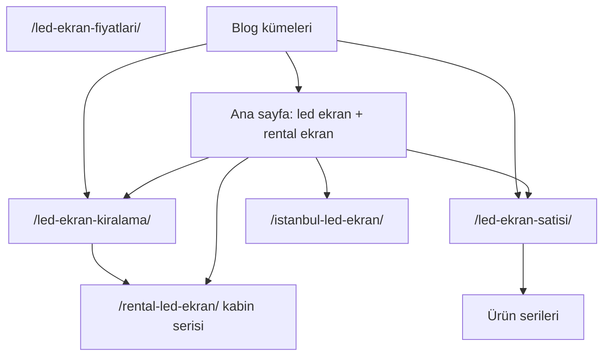

# LED ekran ve Rental Ekran sıralama planı

Kod: [C:\Users\kacma\Projects\rentalekran.com](C:\Users\kacma\Projects\rentalekran.com) (`rentalekran-growth` WordPress eklentisi). Canlı site bu eklentiyi basıyor. Onaydan sonra çalışma kökü bu repoya alınır; plan dosyası `docs/superpowers/plans/2026-10-30-led-rental-ekran-seo.md` olarak da yazılır.

## Teşhis

Ana sayfa başlığı ve H1 şu an **LED ekran satış ve kiralama**. “led ekran” ve “rental ekran” metinde geçiyor ama baş kelime olarak dağınık. `/rental-led-ekran/` ürün sayfası marka sorgusuyla yarışabilir.

Blog yazıları yaklaşık 150–200 kelime. Hizmet, referans, sevkiyat ve ortaklık sayfaları birer kart. Şemada logo, harita, açılış saati ve `og:image` yok; `SearchAction` noindex aramaya gidiyor. Aynı 7 webp tüm sayfalarda dönüyor.

Sıralamayı kod tek başına bitirmez. Google İşletme, gerçek yorum ve dış bağlantı bu planda checklist olarak kalır; uydurma puan veya şube sayfası yazılmaz.

## Kelime mimarisi

- **Ana sayfa** iki baş kelimenin tek URL’si. Ayrı `/led-ekran/` veya `/rental-ekran/` açılmaz; gerekirse ikisi ana sayfaya 301.
- **Title:** `LED Ekran | Rental Ekran Satış ve Kiralama`
- **H1:** `LED ekran`
- Kaş: `RENTAL EKRAN · İSTANBUL`
- İlk paragraf her iki kelimeyi birer kez, doğal cümlede kullanır.
- `**/rental-led-ekran/**` “rental LED ekran / kiralık kabin” niyeti. Title markayı tekrar başa koymaz; `Rental LED Ekran Kabinleri | Sahne ve Fuar` olur. Gövde ana sayfaya “Rental Ekran” markasıyla, kiralama sayfasına hizmetle bağlanır.
- Kiralama, satış, İstanbul, fiyat ve seçim sayfaları kendi uzun kuyruğunda kalır; H1’leri “LED ekran” veya “Rental Ekran” tek başına olmaz.

## Sayfa içeriği

[templates/page.php](C:\Users\kacma\Projects\rentalekran.com\rentalekran-growth\templates\page.php) ana sayfaya dört blok eklenir: LED ekran nedir, Rental ekran nedir (marka + taşınabilir kabin ayrımı), satış/kiralama karşılaştırma tablosu, SSS. Mevcut ürün ızgarası ve teklif CTA kalır.

[templates/guides.php](C:\Users\kacma\Projects\rentalekran.com\rentalekran-growth\templates\guides.php) kiralama, satış, İstanbul ve fiyat metinleri kullanım senaryosu (sahne, fuar, düğün, vitrin, iç/dış) ile uzatılır. Her sayfada ana sayfaya ve ilgili ürüne 2–4 bağlamsal link.

[templates/corporate.php](C:\Users\kacma\Projects\rentalekran.com\rentalekran-growth\templates\corporate.php) hizmet, proje tipi, sevkiyat ve ortaklık metinleri aynı NAP ve iç linklerle doldurulur. Uydurma müşteri adı yok.

[includes/products.json](C:\Users\kacma\Projects\rentalekran.com\rentalekran-growth\includes\products.json) her seride benzersiz intro, title ve bir “bu bir LED ekrandır” cümlesi; rental serisi “rental ekran kabini” tanımını taşır. Aynı paragraf kopyalanmaz.

[includes/keywords.json](C:\Users\kacma\Projects\rentalekran.com\rentalekran-growth\includes\keywords.json) tüm route title/description/FAQ haritası. Ana sayfa SSS: LED ekran nedir, Rental ekran nedir, kiralama mı satış mı, İstanbul’da kim.

[includes/blog-posts.json](C:\Users\kacma\Projects\rentalekran.com\rentalekran-growth\includes\blog-posts.json) mevcut 12 yazı ve kuyruktaki yayınlanmamış başlıklar 700+ kelimeye çıkarılır. Her yazı ana sayfa, kiralama veya satıştan birine ve bir ürüne bağlanır. `blogSync` sürümü artar ki canlı WordPress yazıları güncellesin. Yeni yazıların odağı baş kelimeyi çalmaz: sahne, fuar, P2.6, showroom, kontrol sistemi.

Menü ve footer ([includes/layout.php](C:\Users\kacma\Projects\rentalekran.com\rentalekran-growth\includes\layout.php)): “LED ekran” ve “Rental Ekran” site genelinde exact-match spam olmaz. Footer açıklaması iki kelimeyi bir kez geçer. Nav’da kiralama/satış linkleri durur.

## Teknik SEO ve harita

[includes/seo.php](C:\Users\kacma\Projects\rentalekran.com\rentalekran-growth\includes\seo.php):

- `og:image` + `twitter:card=summary_large_image` (mevcut `rental-led-ekran.webp`, 1200 genişlik sinyali)
- Organization’a logo, telefon, e-posta, adres
- Ana sayfa ve İstanbul/iletişim: `hasMap` (Google Haritalar arama linki, adres: Halide Edip Adıvar Mah. Gül 2 Sk. No:10a, Şişli)
- Doğrulanmamış enlem uydurulmaz
- `SearchAction` kaldırılır
- Ana sayfa FAQ şeması
- Ürün SSS’leri mevcut FAQ şemasına eklenir (sayfada zaten var)
- Breadcrumb durur

İletişim ve İstanbul şablonuna harita gömme (`maps?q=` adres sorgusu) ve tıklanabilir NAP.

[tests/audit.test.mjs](C:\Users\kacma\Projects\rentalekran.com\tests\audit.test.mjs) eski title kilidi yeni title’a çekilir; ana sayfa H1, FAQ ve `og:image` assert edilir.

## Görseller

Yeni stok “müşteri projesi” fotoğrafı üretilmez. Mevcut webp’ler kalır. Alt metinler sayfa niyetine göre yazılır (ör. ana hero: `Rental Ekran LED ekran modüler kabin`). Eksik width/height tamamlanır. Transparan temsili şema “temsili” olarak işaretli kalır.

## Doğrulama

- `node tests/audit.test.mjs`
- Değişen PHP dosyalarında `php -l`
- Tarayıcıda ana sayfa, kiralama, satış, rental LED, İstanbul, iletişim: H1, title, harita, iç link, mobil 390px

Canlıya alma `main` push ile FTP deploy’dur. Uygulama bitince push ayrıca sorulur; onay olmadan production’a gitmez.

## Sizin tarafta kalanlar

- Google İşletme Profili: aynı NAP, kategori LED ekran / tabela, web sitesi ana sayfa
- Search Console’da sitemap: `https://rentalekran.com/wp-sitemap.xml`
- Gerçek kurulum fotoğrafı ve yorum gelirse sonra şemaya eklenir
## Uygulama güncellemesi — 30 Ekim 2026

- Kullanıcının bu konuşmadaki doğrudan canlıya alma izni, yukarıdaki yeniden push onayı isteme adımının yerini alır.
- Mevcut blog arşivi 12 değil 19 yazı; mevcut altı kuyruk girdisi ve gelecek konu havuzu da içerik derinliği kapsamındadır.
- Mevcut sosyal görsel 1024 × 576: gerçek dosya boyutları kullanılır, 1200 piksel olduğu iddia edilmez.
- Çalışma saati, koordinat, değerlendirme puanı veya müşteri referansı doğrulanmadığı için eklenmez. Mevcut ayarlardaki NAP kullanılır.
- İleri tarihli yazılar eşitlemede bulunmadığından tekrar oluşma hatası testle üretildi; future durumundaki kayıtlar da güncellenerek giderildi.
- Ürün ve hizmet mimarisi aynı WordPress eklentisi ve mevcut URL’ler üzerinde korunur. Yeni baş kelime hub sayfası açılmaz.

### Kontroller

`node tests/audit.test.mjs` içerik derinliği ve kelime mimarisini de çalıştırır.
Yerel WordPress açıkken `node tests/seo-http.test.mjs` altı ana rotanın gerçek HTML/şema çıktısını doğrular.
`tests/integration/blog-sync.php` yerel WP-CLI `eval-file` ile çalıştırılır; eşitleme öncesi ve sonrası planlanmış yazı sayısının aynı kalmasını denetler.
Mobil 390px ve masaüstü 1366px tarayıcı kontrolü; H1, başlık, yatay taşma ve JavaScript hatalarını kapsar.

### Doğrulama sonucu

- 19 arşiv yazısı: 750–838 görünür kelime; altı kuyruk yazısı ve 15 konu tohumu da 700+ kelime.
- Node.js 20 ile mevcut audit ve SEO içerik kontrolleri geçti.
- Eklentinin 11 PHP dosyasının sözdizimi kontrolü geçti.
- Yerel 37 sayfa, altı planlanmış yazının beklenen 404 yanıtı, iki 301, REST/statik varlıklar ve yerelde yakalanan form akışı doğrulandı.
- Altı ana rotanın canonical/H1/şema/sosyal görsel/harita çıktısı ve 390/1366px tarayıcı kontrolleri geçti.
- Aynı blog eşitlemesini tekrar çalıştırmak planlanmış yazıları çoğaltmıyor.
- Bağımsız kod ve içerik incelemesinde açık bulgu kalmadı.
- Canlı doğrulama ve GitHub Actions API erişimi, ortam ağ politikası izin verene kadar ayrı bir adım olarak kalır. Alan adları ortam taslağına eklendi; taslağı kaydetmek çalışan ağ politikasını kendiliğinden değiştirmez.
